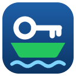
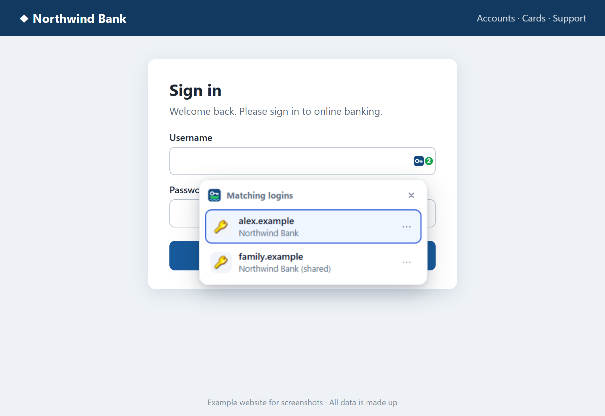
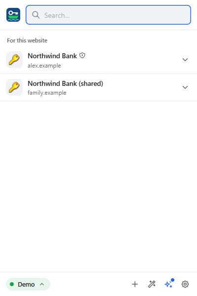
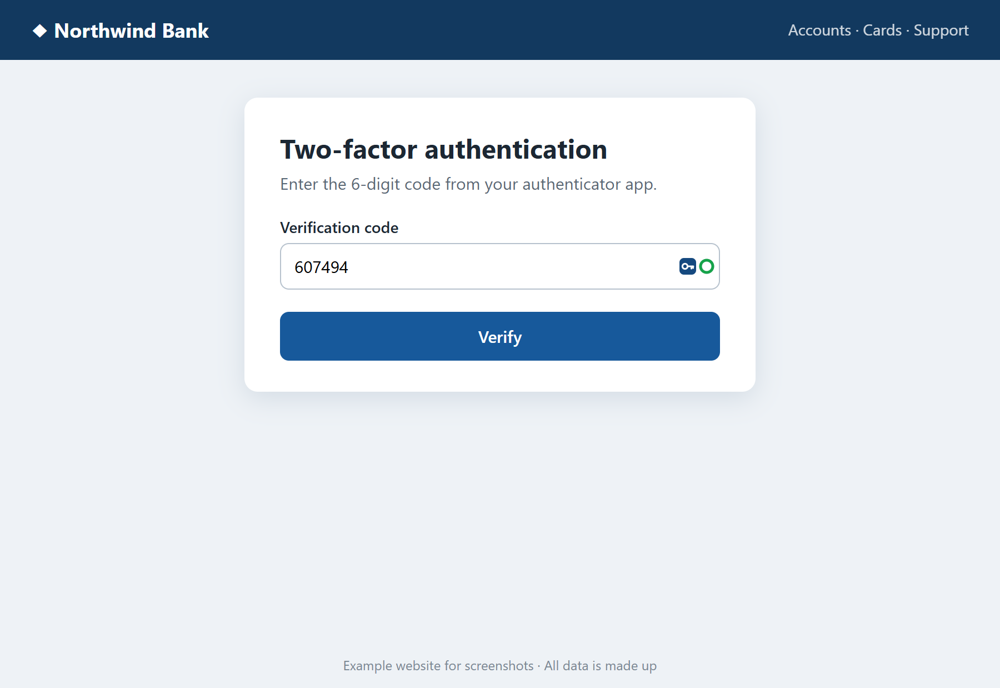
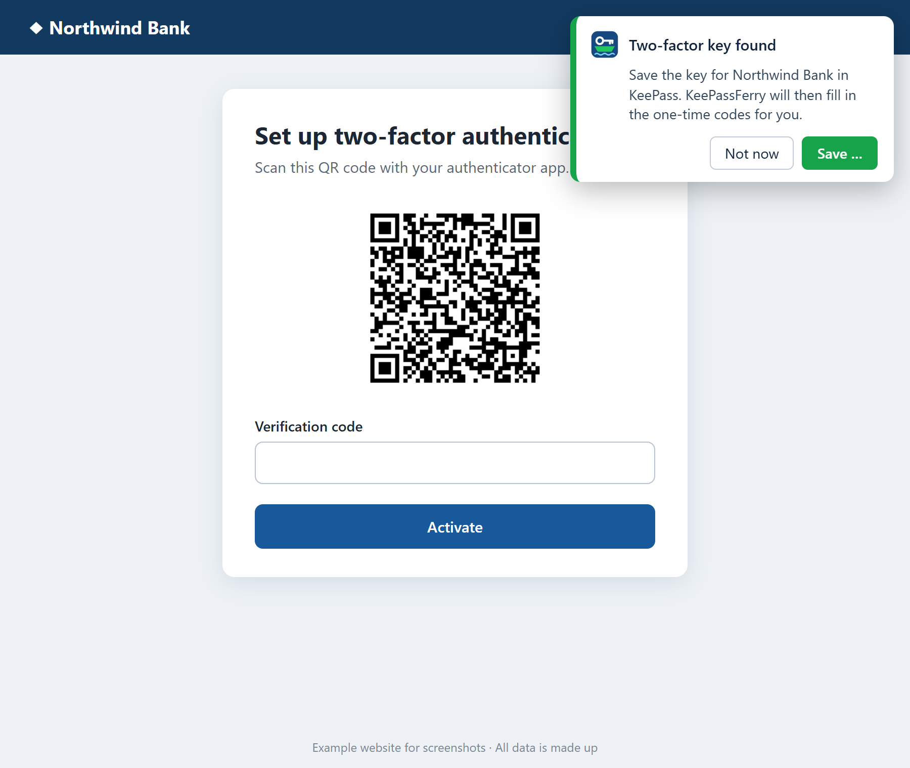
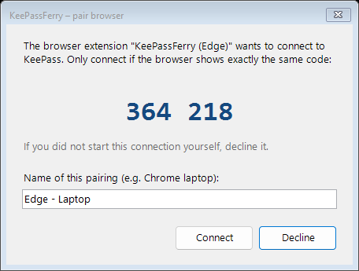
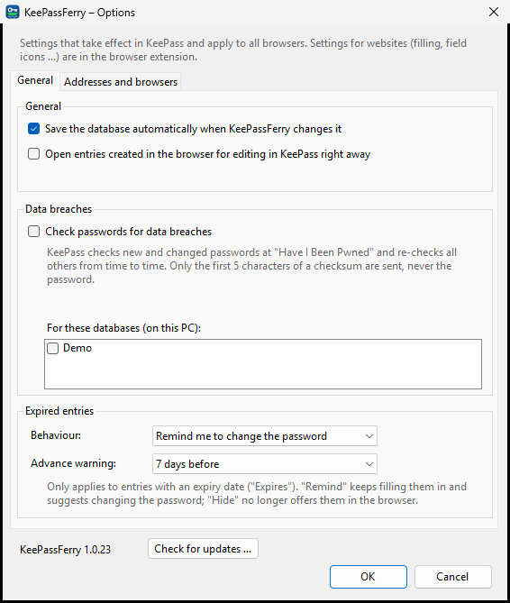
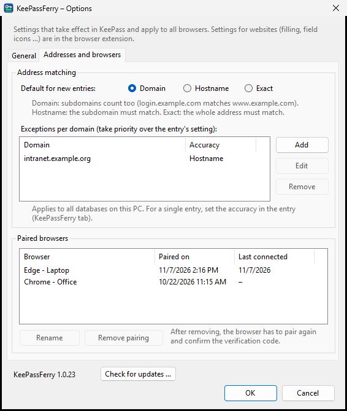

<p align="center">
  
</p>

<h1 align="center">KeePassFerry</h1>

<p align="center">
  Secure browser integration for <a href="https://keepass.info">KeePass Password Safe 2</a> on Windows:<br>
  logins, one-time codes and passkeys from your own KeePass database — no open ports, no cloud.
</p>

<p align="center">
  <a href="https://github.com/KeePassFerry/KeePassFerry/releases/latest/download/KeePassFerry-Setup.exe"><b>Download setup for KeePass</b></a>
  &nbsp;·&nbsp;
  <a href="https://microsoftedge.microsoft.com/addons/detail/ghkhbdnhojpeibdjdlgojfdjhedapmhg"><b>Get it for Microsoft Edge</b></a>
  &nbsp;·&nbsp;
  <a href="https://chromewebstore.google.com/detail/fhciciajogahdkbmeliechblahlhpmga"><b>Get it for Google Chrome</b></a>
</p>

<p align="center">🇩🇪 <a href="#deutsch">Deutsche Beschreibung weiter unten</a></p>

---

## Screenshots

| Choose a login right at the field | Everything for this website in the popup |
| --- | --- |
|  |  |

| One-time code filled in, with a validity ring | Two-factor setup detected from a QR code |
| --- | --- |
|  |  |

| Pairing with a code you confirm | Options in KeePass | Addresses and paired browsers |
| --- | --- | --- |
|  |  |  |

<sub>Example data: a made-up website, a demo database and invented accounts.</sub>

## Features

### Logins

- **Fill from the field.** An icon in the field shows how many logins match. Choosing one fills username *and*
  password, also across multi-step logins where the password comes on a second page.
- **Fill exactly one value.** The **⋯** button of an entry fills or copies a single value into the field: username,
  password, one-time code or your own KeePass fields such as a PIN or customer number.
- **Save without clutter.** A new entry only takes the username and password of a form, not the address or checkboxes
  of a registration page. If a site really needs another field, right-click it → **KeePassFerry → Add this field to the
  entry**. It is stored as a KeePass string field, gets the icon and is filled in from then on.
- **Changed passwords.** After a successful login with a new password, KeePassFerry offers to update the existing
  entry. The old password stays in the entry's KeePass history.
- **Search and edit from the popup:** search the whole database, view notes, custom fields and attachments, or open
  the entry in KeePass.

### Two-factor codes and passkeys

- **One-time codes (TOTP)** are filled in automatically, with a validity ring at the field.
- **Two-factor setup:** when a page shows a QR code or `otpauth://` link with a valid key, KeePassFerry offers to store
  it in the right existing entry. You can also paste a screenshot of a QR code; the image itself is not stored.
- **Passkeys (WebAuthn)** are stored in your KeePass entry in KeePassXC-compatible fields, preferably next to the
  existing password. The WebAuthn Signal API is supported.

### Security checks

- **Leaked passwords:** optional check against "Have I Been Pwned", switched on per database. Only the first 5
  characters of a checksum leave your PC. Affected entries get a warning and, where known, a direct "Change password" link.
- **Expiry dates:** entries with an expiry date can remind you to change the password or be hidden in the browser.
- **Password generator** that follows the password rules of many websites.
- **Related websites:** logins are also offered on other domains of the same provider, based on Apple's open
  [Password Manager Resources](https://github.com/apple/password-manager-resources).

### Everyday use

- **Unlock with Windows Hello** in the background: click the icon of a locked field or the extension and only the Hello
  prompt appears (requires [KeePassWinHello](https://github.com/sirAndros/KeePassWinHello) or similar).
- **Your choice of match accuracy:** domain, hostname or exact address, as a default and as exceptions per domain, for
  all databases on the PC.
- **Several databases:** the popup shows which are open; read-only databases are not offered for saving.
- **Several browsers:** each browser is paired on its own and can be given a name of your choice.
- Modern UI with light and dark theme, German and English.

## How it works

```
Browser extension ──native messaging──▶ KeePassFerryHost.exe ──named pipe (per Windows user)──▶ KeePass plugin
```

- No WebSocket or network port; the pipe is only accessible to your Windows account and only the bundled host
  executable may connect.
- End-to-end encrypted channel (ECDH P-256, HKDF-SHA-256, AES-256-GCM, replay protection), paired once with a
  six-digit code that you confirm in KeePass.
- The TOTP secret and the passkey's private key stay in KeePass: the extension receives a code or a signature.

## Requirements

- Windows 10/11, KeePass Password Safe 2.48 or newer (tested with 2.61.1), .NET Framework 4.8
- Microsoft Edge or Google Chrome (other Chromium browsers and Firefox are not tested yet)

## Installation

1. Download and run [`KeePassFerry-Setup.exe`](https://github.com/KeePassFerry/KeePassFerry/releases/latest/download/KeePassFerry-Setup.exe).
   It finds your KeePass installation (or lets you choose the folder of a portable KeePass), closes KeePass if
   needed and installs the plugin. Uninstall via *Settings → Apps*.
   Alternatively extract the folder `KeePassFerry` from `KeePassFerry-Plugin-<version>.zip` into the `Plugins`
   folder of KeePass while KeePass is closed.
2. Start KeePass and open your database. KeePass reports new plugin versions through its own update check.
3. Install the browser extension from
   [Microsoft Edge Add-ons](https://microsoftedge.microsoft.com/addons/detail/ghkhbdnhojpeibdjdlgojfdjhedapmhg) or the
   [Chrome Web Store](https://chromewebstore.google.com/detail/fhciciajogahdkbmeliechblahlhpmga).
4. When the browser connects for the first time, KeePass and the browser show the same six-digit code. Give the pairing
   a name if you like and click **Connect** in KeePass only if both codes match.

KeePassFerry does not need Kee or KeePassRPC and can be installed alongside them.

> **Tip for Microsoft Edge:** New versions usually reach the Chrome Web Store sooner than Edge Add-ons, and the Chrome
> version also runs in Edge. On `edge://extensions`, turn on *Allow extensions from other stores*, install KeePassFerry
> from the [Chrome Web Store](https://chromewebstore.google.com/detail/fhciciajogahdkbmeliechblahlhpmga) and turn off the
> Edge Add-ons version. This counts as a separate installation, so you confirm the pairing code again and set the
> extension's settings anew.

## Settings

- **In KeePass:** *Tools → KeePassFerry options* holds everything that takes effect in KeePass and applies to all
  browsers: saving, data breaches, expired entries, address matching and paired browsers.
- **In the browser:** the extension's settings hold everything that only affects websites, such as filling and field
  icons.

## Building

| Part | Folder | Command |
|---|---|---|
| Extension | `extension/` | `npm ci` then `npm run build-chrome:prod` (output in `extension/extension/`) |
| Plugin | `plugin/` | `msbuild plugin/KeePassFerry/KeePassFerry.csproj -p:Configuration=Release -p:TargetFrameworkVersion=v4.8` (expects `KeePass.exe` in `%USERPROFILE%\KeePassDEV`) |
| Host | `host/` | `dotnet build host/KeePassFerryHost -c Release` |

Releases are built by GitHub Actions when a tag `v*` is pushed (see `.github/workflows/release.yml`).

For testing a release build of the extension: extract `KeePassFerry-Extension-<version>.zip`, open `edge://extensions`,
enable developer mode and choose "Load unpacked".

For manual testing without real accounts, `testsite/` contains a local test website (login, password change,
multi-step login, two-factor setup and codes): `node testsite/server.mjs`, then open `http://127.0.0.1:8080/`
(see `testsite/README.md`).

## Privacy

KeePassFerry has no servers, no telemetry and no tracking. It does not transfer any information to other networked
systems unless the user starts it: KeePass's own update check, if enabled in KeePass, reads `version.txt` from
GitHub, and updates are downloaded from GitHub only when the user starts them. The optional check for leaked
passwords (off by default) sends only the first 5 characters of a SHA-1 checksum per password to "Have I Been Pwned".
See [PRIVACY.md](PRIVACY.md).

## Release integrity

Releases are built by GitHub Actions from this repository and published only after manual approval. Each release
contains `SHA256SUMS.txt`, signed with the KeePassFerry release key (kept offline, see `signing/`); the plugin
installs one-click updates only if this signature is valid. The Windows setup is not Authenticode-signed yet, so
Windows shows "Unknown publisher".

## Credits and licences

KeePassFerry is a fork of **Kee** (Kee Vault Ltd and contributors, AGPL v3) and **KeePassRPC**
(Chris Tomlinson and contributors, GPL v2). Thank you! Details in [NOTICE.md](NOTICE.md).

- `extension/` – GNU Affero General Public License v3 ([LICENSE](extension/LICENSE))
- `plugin/` and `host/` – GNU General Public License v2 ([LICENSE](plugin/LICENSE))

Not affiliated with Kee Vault Ltd or the KeePass project.

---

## Deutsch

### Worum es geht

KeePassFerry verbindet Microsoft Edge und Google Chrome sicher mit KeePass 2 unter Windows. Anmeldedaten, Einmalcodes
und Passkeys kommen direkt aus deiner eigenen Datenbank. Es gibt kein Konto, keine Cloud und keinen offenen Netzwerkport,
und deine Datenbank bleibt, wo sie ist.

Die Screenshots oben zeigen die englische Oberfläche. KeePassFerry richtet sich nach deiner Sprache: Die Erweiterung
folgt dem Browser, das Plugin der Sprache von KeePass.

### Was du davon hast

**Anmelden**

- **Ausfüllen direkt am Feld.** Ein Symbol im Feld zeigt, wie viele Einträge passen. Wählst du einen aus, werden
  Benutzername *und* Passwort eingetragen, auch bei Anmeldungen in zwei Schritten.
- **Nur einen Wert eintragen.** Der Knopf **⋯** an einem Eintrag trägt einen einzelnen Wert ins Feld ein oder kopiert
  ihn: Benutzername, Passwort, Einmalcode oder eigene KeePass-Felder wie PIN oder Kundennummer.
- **Speichern ohne Ballast.** Ein neuer Eintrag übernimmt nur Benutzername und Passwort, nicht Anschrift oder
  Häkchen einer Registrierung. Braucht eine Seite wirklich ein weiteres Feld: Rechtsklick hinein → **KeePassFerry →
  Dieses Feld zum Eintrag hinzufügen**. Es liegt dann als Zeichenfolge im KeePass-Eintrag, bekommt das Symbol und wird künftig mit
  ausgefüllt.
- **Geänderte Passwörter.** Nach einer erfolgreichen Anmeldung mit neuem Passwort bietet KeePassFerry an, den
  vorhandenen Eintrag zu aktualisieren. Das alte Passwort bleibt in der Chronik des Eintrags erhalten.
- **Suchen und Nachsehen im Popup.** Du kannst die ganze Datenbank durchsuchen, Notizen, eigene Felder und Anhänge
  ansehen oder den Eintrag in KeePass öffnen.

**Zwei-Faktor und Passkeys**

- **Einmalcodes (TOTP)** werden automatisch eingetragen, ein Ring am Feld zeigt die restliche Gültigkeit.
- **Zwei-Faktor einrichten.** Zeigt eine Seite einen QR-Code oder `otpauth://`-Link mit gültigem Schlüssel, bietet
  KeePassFerry an, ihn im passenden Eintrag zu speichern. Du kannst auch einen Screenshot des QR-Codes einfügen; das
  Bild selbst wird nicht gespeichert.
- **Passkeys (WebAuthn)** liegen in deinem KeePass-Eintrag, in denselben Feldern wie bei KeePassXC und möglichst neben
  dem vorhandenen Passwort. Die WebAuthn Signal API wird unterstützt.

**Sicherheit**

- **Datenlecks.** Die Prüfung über „Have I Been Pwned“ ist freiwillig und wird je Datenbank eingeschaltet. Dein PC
  verlässt dabei nur die ersten 5 Zeichen einer Prüfsumme. Betroffene Einträge bekommen eine Warnung und, wenn bekannt, einen
  direkten Link „Passwort ändern“.
- **Ablaufdaten.** Einträge mit Ablaufdatum können an den Passwortwechsel erinnern oder im Browser ausgeblendet werden.
- **Passwortgenerator**, der die Passwortregeln vieler Websites beachtet.
- **Zugehörige Websites.** Anmeldedaten werden auch auf anderen Domains desselben Anbieters angeboten. Die Grundlage
  ist Apples offene Liste [Password Manager Resources](https://github.com/apple/password-manager-resources).

**Im Alltag**

- **Entsperren per Windows Hello** im Hintergrund: Ein Klick auf das Symbol im gesperrten Feld oder auf die Erweiterung
  genügt, und es erscheint nur die Hello-Abfrage. Dafür brauchst du
  [KeePassWinHello](https://github.com/sirAndros/KeePassWinHello) oder etwas Vergleichbares.
- **Genauigkeit beim Adressabgleich.** Domain, Hostname oder exakte Adresse, als Standard und als Ausnahme je Domain,
  gültig für alle Datenbanken auf dem PC.
- **Mehrere Datenbanken.** Das Popup zeigt, welche offen sind; schreibgeschützte werden zum Speichern nicht angeboten.
- **Mehrere Browser.** Jeder Browser wird einzeln gekoppelt und kann einen eigenen Namen bekommen.
- Moderne Oberfläche mit hellem und dunklem Design, auf Deutsch und Englisch.

### So funktioniert es technisch

```
Browser-Erweiterung ──Native Messaging──▶ KeePassFerryHost.exe ──Named Pipe (je Windows-Benutzer)──▶ KeePass-Plugin
```

- **Kein Netzwerkport.** Es gibt keinen WebSocket und keinen offenen Port. Die Pipe ist nur für dein Windows-Konto
  erreichbar, und nur das mitgelieferte Host-Programm darf sich verbinden.
- **Ende-zu-Ende-verschlüsselt** (ECDH P-256, HKDF-SHA-256, AES-256-GCM, Schutz gegen Wiedereinspielen). Gekoppelt wird
  einmalig mit einem sechsstelligen Code, den du in KeePass bestätigst.
- **Schlüssel bleiben in KeePass.** Das TOTP-Geheimnis und der private Schlüssel des Passkeys bleiben dort, die
  Erweiterung erhält nur einen Code oder eine Signatur.

### Voraussetzungen

- Windows 10/11, KeePass Password Safe 2.48 oder neuer (getestet mit 2.61.1), .NET Framework 4.8
- Microsoft Edge oder Google Chrome (andere Chromium-Browser und Firefox sind noch nicht getestet)

### Installation

1. [`KeePassFerry-Setup.exe`](https://github.com/KeePassFerry/KeePassFerry/releases/latest/download/KeePassFerry-Setup.exe)
   herunterladen und ausführen. Das Setup findet deine KeePass-Installation (oder fragt nach dem Ordner einer portablen
   Version), schließt KeePass bei Bedarf und installiert das Plugin. Deinstallieren kannst du es unter
   *Einstellungen → Apps*. Alternativ entpackst du bei geschlossenem KeePass den Ordner `KeePassFerry` aus
   `KeePassFerry-Plugin-<Version>.zip` in den Ordner `Plugins` von KeePass.
2. KeePass starten und die Datenbank öffnen. Neue Plugin-Versionen meldet KeePass über seine eigene Update-Prüfung.
3. Die Erweiterung aus [Microsoft Edge Add-ons](https://microsoftedge.microsoft.com/addons/detail/ghkhbdnhojpeibdjdlgojfdjhedapmhg)
   oder dem [Chrome Web Store](https://chromewebstore.google.com/detail/fhciciajogahdkbmeliechblahlhpmga) installieren.
4. Beim ersten Verbinden zeigen KeePass und der Browser denselben sechsstelligen Code. Gib der Kopplung auf Wunsch einen
   Namen und klicke in KeePass nur dann auf **Verbinden**, wenn beide Codes übereinstimmen.

KeePassFerry braucht weder Kee noch KeePassRPC und kann daneben installiert sein.

> **Tipp für Microsoft Edge:** Neue Versionen erscheinen im Chrome Web Store meist früher als bei Edge Add-ons, und die
> Chrome-Version läuft auch in Edge. Schalte unter `edge://extensions` *Erweiterungen aus anderen Stores zulassen* ein,
> installiere KeePassFerry aus dem [Chrome Web Store](https://chromewebstore.google.com/detail/fhciciajogahdkbmeliechblahlhpmga)
> und schalte die Version aus Edge Add-ons aus. Das ist eine eigene Installation: Du bestätigst den Prüfcode noch einmal
> und stellst die Einstellungen der Erweiterung neu ein.

### Einstellungen

- **In KeePass:** Unter *Extras → KeePassFerry-Optionen* liegt alles, was in KeePass wirkt und für alle Browser gilt:
  Speichern, Datenlecks, abgelaufene Einträge, Adressabgleich und gekoppelte Browser.
- **Im Browser:** In den Einstellungen der Erweiterung liegt alles, was nur auf Webseiten wirkt, zum Beispiel Ausfüllen
  und Feldsymbole.

### Datenschutz

KeePassFerry hat keine eigenen Server, keine Telemetrie und kein Tracking. Daten gehen nur nach außen, wenn du es
auslöst: Die Update-Prüfung von KeePass liest, falls in KeePass eingeschaltet, `version.txt` von GitHub, und Updates
werden nur auf deinen Wunsch von GitHub geladen. Die freiwillige Datenleck-Prüfung (standardmäßig aus) sendet je Passwort
nur die ersten 5 Zeichen einer SHA-1-Prüfsumme an „Have I Been Pwned“. Mehr dazu in [PRIVACY.md](PRIVACY.md).

### Vertrauenswürdige Releases

Releases baut GitHub Actions aus diesem Repository, veröffentlicht werden sie erst nach manueller Freigabe. Jedes
Release enthält `SHA256SUMS.txt`, signiert mit dem Release-Schlüssel von KeePassFerry (offline aufbewahrt, siehe
`signing/`). Ein-Klick-Updates installiert das Plugin nur bei gültiger Signatur. Das Windows-Setup ist noch nicht
Authenticode-signiert, deshalb zeigt Windows „Unbekannter Herausgeber“.

### Dank und Lizenzen

KeePassFerry ist ein Fork von **Kee** (Kee Vault Ltd und Mitwirkende, AGPL v3) und **KeePassRPC** (Chris Tomlinson und
Mitwirkende, GPL v2). Danke! Einzelheiten stehen in [NOTICE.md](NOTICE.md). Lizenzen: `extension/` unter GNU AGPL v3,
`plugin/` und `host/` unter GNU GPL v2. Das Projekt steht in keiner Verbindung zu Kee Vault Ltd oder dem KeePass-Projekt.
