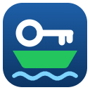

<p align="center">
  
</p>

<h1 align="center">KeePassFerry</h1>

<p align="center">
  Secure browser integration for <a href="https://keepass.info">KeePass Password Safe 2</a> on Windows:<br>
  logins, one-time codes and passkeys from your own KeePass database — no open ports, no cloud.
</p>

<p align="center">
  <a href="https://github.com/KeePassFerry/KeePassFerry/releases/latest/download/KeePassFerry-Setup.exe"><b>Download setup for KeePass</b></a>
  &nbsp;·&nbsp;
  <a href="https://microsoftedge.microsoft.com/addons/detail/ghkhbdnhojpeibdjdlgojfdjhedapmhg"><b>Get it for Microsoft Edge</b></a>
  &nbsp;·&nbsp;
  <a href="https://chromewebstore.google.com/detail/fhciciajogahdkbmeliechblahlhpmga"><b>Get it for Google Chrome</b></a>
</p>

---

## Features

- **Autofill and save logins** like Kee, including search across the whole database and multi-page logins
  (choosing an entry fills username *and* password).
- **One-time codes (TOTP)** filled automatically, with a validity ring at the field; set up 2FA from a QR code or
  secret directly into the right existing entry (`otpauth://` and KeePass `TimeOtp-*` fields).
- **Passkeys (WebAuthn)** stored in your KeePass entry (KeePassXC-compatible fields), preferably next to the
  existing password; supports the WebAuthn Signal API.
- **Unlock with Windows Hello** in the background: open a login page or click the icon and only the Hello prompt
  appears (requires [KeePassWinHello](https://github.com/sirAndros/KeePassWinHello) or similar).
- **Screenshots as attachments** (e.g. security questions) with Ctrl+V.
- Modern UI with light/dark theme, German and English.

## How it works

```
Browser extension ──native messaging──▶ KeePassFerryHost.exe ──named pipe (per Windows user)──▶ KeePass plugin
```

- No WebSocket or network port; the pipe is only accessible to your Windows account and only the bundled host
  executable may connect.
- End-to-end encrypted channel (ECDH P-256, HKDF-SHA-256, AES-256-GCM, replay protection), paired once with a
  six-digit code that you confirm in KeePass.
- Secrets never leave KeePass: the extension receives a code or a signature, not the TOTP secret or passkey key.

## Requirements

- Windows 10/11, KeePass Password Safe 2.48 or newer (tested with 2.61.1), .NET Framework 4.8
- Microsoft Edge or Google Chrome (other Chromium browsers and Firefox are not tested yet)

## Installation

1. Download and run [`KeePassFerry-Setup.exe`](https://github.com/KeePassFerry/KeePassFerry/releases/latest/download/KeePassFerry-Setup.exe).
   It finds your KeePass installation (or lets you choose the folder of a portable KeePass), closes KeePass if
   needed and installs the plugin. Uninstall via *Settings → Apps*.
   Alternatively extract the folder `KeePassFerry` from `KeePassFerry-Plugin-<version>.zip` into the `Plugins`
   folder of KeePass while KeePass is closed.
2. Start KeePass and open your database. KeePass reports new plugin versions through its own update check.
3. Install the browser extension from
   [Microsoft Edge Add-ons](https://microsoftedge.microsoft.com/addons/detail/ghkhbdnhojpeibdjdlgojfdjhedapmhg) or the
   [Chrome Web Store](https://chromewebstore.google.com/detail/fhciciajogahdkbmeliechblahlhpmga).
   For testing a release build: extract `KeePassFerry-Extension-<version>.zip`, open `edge://extensions`, enable
   developer mode and choose “Load unpacked”.
4. When the browser connects for the first time, KeePass and the browser show the same six-digit code. Click
   **Connect** in KeePass only if both match.

KeePassFerry does not need Kee or KeePassRPC and can be installed alongside them.

## Building

| Part | Folder | Command |
|---|---|---|
| Extension | `extension/` | `npm ci` then `npm run build-chrome:prod` (output in `extension/extension/`) |
| Plugin | `plugin/` | `msbuild plugin/KeePassRPC/KeePassRPC.csproj -p:Configuration=Release -p:TargetFrameworkVersion=v4.8` (expects `KeePass.exe` in `%USERPROFILE%\KeePassDEV`) |
| Host | `host/` | `dotnet build host/KeePassFerryHost -c Release` |

Releases are built by GitHub Actions when a tag `v*` is pushed (see `.github/workflows/release.yml`).

## Privacy

KeePassFerry has no servers, no telemetry and no tracking. It does not transfer any information to other networked
systems unless the user starts it: KeePass's own update check, if enabled in KeePass, reads `version.txt` from
GitHub, and updates are downloaded from GitHub only when the user starts them. See [PRIVACY.md](PRIVACY.md).

## Release integrity

Releases are built by GitHub Actions from this repository and published only after manual approval. Each release
contains `SHA256SUMS.txt`, signed with the KeePassFerry release key (kept offline, see `signing/`); the plugin
installs one-click updates only if this signature is valid. The Windows setup is not Authenticode-signed yet, so
Windows shows "Unknown publisher".

## Credits and licences

KeePassFerry is a fork of **Kee** (Kee Vault Ltd and contributors, AGPL v3) and **KeePassRPC**
(Chris Tomlinson and contributors, GPL v2). Thank you! Details in [NOTICE.md](NOTICE.md).

- `extension/` – GNU Affero General Public License v3 ([LICENSE](extension/LICENSE))
- `plugin/` and `host/` – GNU General Public License v2 ([LICENSE](plugin/LICENSE))

Not affiliated with Kee Vault Ltd or the KeePass project.

---

### Deutsch

KeePassFerry verbindet Edge/Chrome sicher mit KeePass 2 unter Windows: Anmeldedaten, Einmalcodes und Passkeys
aus der eigenen Datenbank, Entsperren per Windows Hello, ohne offene Ports und ohne Cloud. Installation:
[`KeePassFerry-Setup.exe`](https://github.com/KeePassFerry/KeePassFerry/releases/latest/download/KeePassFerry-Setup.exe)
ausführen (findet KeePass selbst), Erweiterung aus [Microsoft Edge Add-ons](https://microsoftedge.microsoft.com/addons/detail/ghkhbdnhojpeibdjdlgojfdjhedapmhg)
oder dem [Chrome Web Store](https://chromewebstore.google.com/detail/fhciciajogahdkbmeliechblahlhpmga) installieren, beim ersten Verbinden den Prüfcode in KeePass bestätigen.
